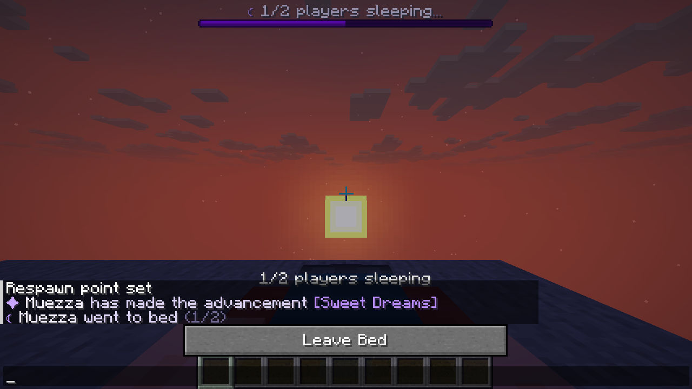
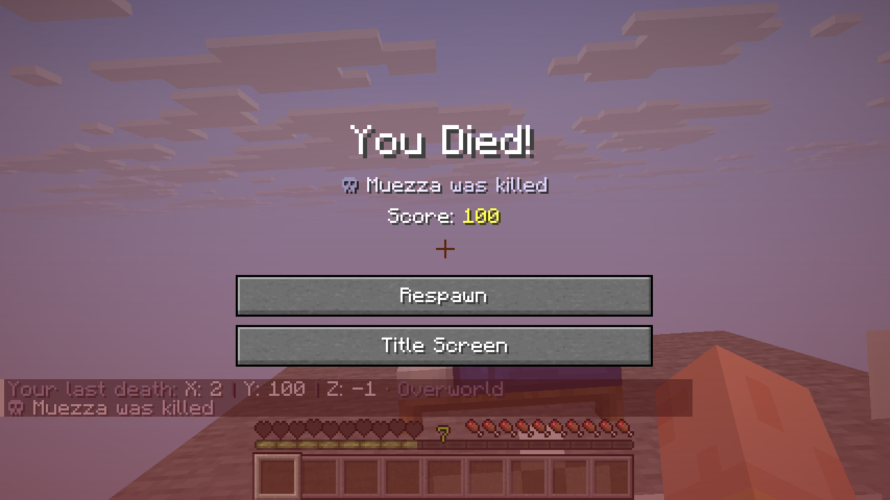

<div align="center">

# ✦ EepyEssentials

**Quality of life and design for the eepy survival server – six modules in one plugin.**

Welcome messages, a modern chat, nicer advancements, sleep progress, calm announcements and styled death messages – in the same violet and blue look as [EepyTab](https://github.com/1870s/EepyTab) and [EepyMOTD](https://github.com/1870s/EepyMOTD), without changing vanilla gameplay.

[](https://github.com/1870s/EepyEssentials/actions/workflows/build.yml)
[](https://github.com/1870s/EepyEssentials/releases/latest)
[](https://papermc.io/)
[](https://adoptium.net/)
[](LICENSE)


<sub>All screenshots in this README are real, taken with the Minecraft 26.1.2 client (launched as a Fabric dev client) on a local Paper 26.1.2 test server running EepyEssentials, EepyTab, EepyMOTD and LuckPerms. Some are cropped to the chat area.</sub>

</div>

---

## ✨ Modules

Every module can be switched on or off on its own (`config.yml` or `/eepyessentials module enable|disable <name>`). A disabled module registers no listeners and runs no tasks, so vanilla behaviour comes back exactly.

| Module | What it does |
|---|---|
| 👋 **EepyWelcome** | Styled join/leave lines, a different greeting for new players, a private welcome (chat, title, action bar, sound) |
| 💬 **EepyChat** | Rank prefixes from LuckPerms or config, name hover and click, clickable links, gentle anti-spam, chat clear, optional private messages |
| ⭐ **EepyAchievements** | Nicer advancement messages with different looks for tasks, goals and challenges |
| 🌙 **EepySleep** | Shows how many players sleep and how many are needed (boss bar, action bar or chat); night skipping stays vanilla |
| 📣 **EepyAnnouncements** | Calm automatic announcements (website, Discord, rules, ...) and `/eepyannounce` |
| ☠️ **EepyDeaths** | Styled death messages with the exact vanilla cause and private death coordinates, `/lastdeath` |

### 👋 EepyWelcome

```
✦ Please welcome Steve to eepy!          ← public, first join
+ Steve                                  ← public, returning player
- Steve                                  ← public, leave

✦ Welcome back, Steve!                   ← private, only Steve sees this
Enjoy your time on eepy. 4 online right now.
```

- New players get "Welcome to eepy!" with the website and Discord as clickable links, plus a title.
- The vanilla message is replaced in the same event, so it never shows twice. `replace-vanilla: false` keeps vanilla; `enabled: false` removes join or leave lines entirely.
- Permission groups can get their own public join/leave line (`groups:`), e.g. for staff.
- Title, subtitle, action bar, chat and sound can each be turned on or off, and the private greeting has a configurable delay.
- Vanished players get no public message.

### 💬 EepyChat


```
OWNER │ Muezza › Hello everyone! Have you seen eepy.at yet?
Steve › Hey Muezza! The new chat looks really nice
```

- **Same ranks and look as the EepyTab player list.** Hovering a name shows player, rank and world; clicking it suggests `/msg <name> `.
- **LuckPerms:** the primary group, or else the heaviest inherited group, picks the rank, so group weights are respected. `prefix-source` decides between `CONFIG`, `LUCKPERMS` and `AUTO` (config prefix for known groups, LuckPerms prefix for others). Only one prefix is ever shown and the player's real name is used, so prefixes are never doubled.
- **Without LuckPerms:** ranks come from `eepyessentials.rank.<id>` permissions (never given to operators automatically).
- Links in messages become clickable. Players with `eepyessentials.chat.format` may use colour/style tags (no click or hover tags).
- **Anti-spam:** 1 s between messages and no identical message within 15 s. `eepyessentials.chat.bypass` skips it.
- `/eepychat clear` (staff keep their chat with `eepyessentials.chat.clear.bypass`).
- **Private messages** `/pm` (`/dm`) and `/reply` (`/r`) are **off by default**, because the vanilla `/msg` stays available and is the only one with Minecraft's chat signing. EepyChat never touches `/msg`.

### ⭐ EepyAchievements


```
✦ Steve has made the advancement [Stone Age]
★ Steve has completed the challenge [Monsters Hunted]
```

- Tasks, goals and challenges each get their own symbol and colour; hovering the name shows the description.
- The challenge earner gets an optional action bar/title/sound; there is also an optional broadcast sound.
- Only the chat line changes: advancements, toasts and rewards are vanilla.
- If vanilla wouldn't announce an advancement (hidden ones, recipes, `announceAdvancements` off, removed by another plugin), nothing is announced here either.
- Single advancements can be excluded.

### 🌙 EepySleep




- Shows `☾ 1/2 players sleeping...` in a boss bar (default), the action bar or chat, plus optional "went to bed" and "Good morning! The night was skipped." lines.
- **Skipping the night is pure vanilla** (game rule `playersSleepingPercentage`). The module counts exactly like vanilla: spectators and players marked as "sleeping ignored" don't count, and at least one sleeper is always needed.
- **Optional gameplay change:** `percentage:` can set that game rule per world (100 = everyone, 50 = half, 1 = one player). It is off by default (`-1`) and the old value is restored when the module stops.
- Updates are event-driven (bed, quit, world or game mode change), with no polling.
- Worlds can be excluded.

### 📣 EepyAnnouncements


```
✦ Stay connected
Visit our website eepy.at · rules, guides & news
```

- **Not spammy by design:**
  - One announcement every **15 minutes** (minimum 3); the first comes **10 minutes** after a start or reload, so a restart never causes a burst.
  - Never the same one twice in a row, and none while nobody (or fewer than `min-players`) is online.
- Order is `RANDOM` or `SEQUENTIAL`. Announcements can be restricted to a permission, worlds, weekdays or times (e.g. Friday 18:00–22:00).
- Each announcement can show chat lines, an action bar and a title, plus a sound. `<website_link>` and `<discord_link>` are clickable.
- `/eepyannounce <message>` (MiniMessage allowed) sends a one-off announcement.

### ☠️ EepyDeaths




```
☠ Steve was slain by Zombie                    ← mob
⚔ Steve was slain by Alex using [Diamond Sword] ← PvP
☠ Alex fell from a high place                  ← environment (muted symbol)
Your last death: X: 1250 | Y: 64 | Z: -320 · Overworld   ← only the victim sees this
```

- The vanilla death message is kept as it is (exact cause, killer and weapon, shown in each player's own language) and only gets a symbol and colours.
- PvP, mob and environment deaths look different. Damage types can be hidden (e.g. `minecraft:fall`), or all public death messages turned off.
- The victim privately gets their coordinates and dimension; clicking copies `x y z`. `/lastdeath` shows them again.
- `/lastdeath` uses the position Minecraft already stores (the one the recovery compass points to), so EepyEssentials saves no data of its own.
- Inventory, XP, drops and respawn are never touched.

## 📦 Installation

1. Download `EepyEssentials-x.y.z.jar` from [**Releases**](https://github.com/1870s/EepyEssentials/releases/latest).
2. Put it into `plugins/` (optionally with LuckPerms) and restart the server.
3. Adjust the files in `plugins/EepyEssentials/` and run `/eepyessentials reload`.

**Requirements:** [Paper](https://papermc.io/downloads/paper) 26.1.2 · Java 25 · LuckPerms optional

| Paper | Status |
|---|:---:|
| 26.1.2 | ✅ tested on a live server with the real client, LuckPerms 5.5.90, EepyTab and EepyMOTD |
| 26.2, 26.3 | ⚙️ compiles against the API (checked weekly by CI), not play-tested |

## ⚙️ Configuration

```
plugins/EepyEssentials/
├── config.yml          modules on/off, branding, palette, LuckPerms, compatibility warnings
├── messages.yml        prefix and command messages
└── modules/
    ├── welcome.yml
    ├── chat.yml
    ├── achievements.yml
    ├── sleep.yml
    ├── announcements.yml
    └── deaths.yml
```

- **Every text is MiniMessage** and every file is commented. All modules share the palette tags from EepyTab and EepyMOTD (`<primary>`, `<secondary>`, `<highlight>`, `<text>`, `<muted>`, `<subtle>`, `<line>`, `<good>`, `<warn>`, `<bad>`), the branding tags `<website>` `<discord>` `<ip>` `<server_name>`, the clickable `<website_link>` `<discord_link>` and `<prefix>`.
- **Missing keys** use the bundled defaults, and your files are never overwritten on updates.
- **Invalid values** (wrong number, unknown sound, misspelled option) are reported with their exact path on load and replaced by the default.
- **A file with a YAML error** is rejected on reload and its previous version stays active. The other files and modules keep working.
- **If a module fails to start,** it is marked as failed in `/eepyessentials modules` and cleaned up; the other modules keep running.

## 🎮 Commands & permissions

| Command | Permission (default) | Description |
|---|---|---|
| `/eepyessentials` (`/eessentials`) | – | Plugin info |
| `/eepyessentials help` | – | Commands you can use |
| `/eepyessentials reload` | `eepyessentials.reload` (op) | Reload all files and restart the modules |
| `/eepyessentials modules` | `eepyessentials.modules` (op) | Module overview (● on, ○ off, ✖ failed) |
| `/eepyessentials module enable\|disable <name>` | `eepyessentials.modules` (op) | Switch a module now and save it in config.yml |
| `/eepyessentials debug` | `eepyessentials.debug` (op) | Versions, LuckPerms, per-module status, overlapping plugins |
| `/lastdeath [player]` | `eepyessentials.death.location` (everyone), `…death.location.others` (op) | Last death position |
| `/eepyannounce <message>` (`/announce`) | `eepyessentials.announce` (op) | Manual announcement |
| `/eepychat clear` | `eepyessentials.chat.clear` (op) | Clear the chat |
| `/pm <player> <message>` (`/dm`), `/reply` (`/r`) | `eepyessentials.chat.pm` (everyone) | Private messages, only when enabled in chat.yml |

More permissions: `eepyessentials.admin` (all admin permissions), `eepyessentials.chat.bypass` (anti-spam), `eepyessentials.chat.clear.bypass`, `eepyessentials.chat.format` (colours in chat), `eepyessentials.rank.<id>` (chat rank without LuckPerms). All commands have tab completion; commands of disabled modules are hidden.

## 🔐 LuckPerms

LuckPerms is optional (`integrations.luckperms` in config.yml).

- **Ranks:** the primary group picks the rank; if it has no rank entry, the heaviest inherited group with one is used.
- **Prefixes and suffixes** are read from LuckPerms' cached meta (`&` codes, `§` codes, hex and MiniMessage all work).
- **Changes apply instantly:** EepyEssentials listens to LuckPerms' recalculation events and refreshes the player on the main thread.
- **Without LuckPerms**, ranks come from permissions, and the plain permission check is repeated once a minute.

## 🧩 Compatibility

**With EepyTab and EepyMOTD:**
- The tab list (EepyTab) and the server list (EepyMOTD) are not touched.
- EepyChat uses the same ranks, prefixes and colours as EepyTab's player list, so the tab list and chat match without double prefixes.
- All three plugins read LuckPerms independently and only read, so they never conflict.

**With other plugins:** EepyEssentials warns at startup (and in `/eepyessentials debug`) when a plugin that does the same thing is installed:

| Module | Overlaps with |
|---|---|
| EepyChat | EssentialsChat, LPC, ChatControl, VentureChat, CarbonChat, DeluxeChat, ChatManager, CMI |
| EepySleep | Harbor, BetterSleeping, SimpleSleep, SleepMost |
| EepyAnnouncements | AnnouncerPlus, AutoBroadcast, AutoMessage |
| EepyDeaths / EepyAchievements | DeathMessagesPrime, AdvancementAnnouncer, CMI |

Turn off the feature in one of them (e.g. `modules.chat: false`). `chat.yml` has `listener-priority` to decide which chat plugin wins. EssentialsX itself works fine next to EepyEssentials: it doesn't format chat unless EssentialsChat is installed.

**Chat signing:** EepyChat only replaces Paper's chat *renderer*; the signed message content is never modified. The 26.1.2 client marks a line as "modified" only when the shown text no longer contains the original message or uses a custom font. EepyChat keeps the text, so normal messages stay secure. Only players allowed to use colour tags (`eepyessentials.chat.format`) can produce a "modified" mark, because their visible text differs from what they typed.

## 🛡️ Vanilla survival principles

There is no economy, no levels, no teleports, no recipe changes, no damage changes, no particles, no resource pack and no client mod.

The only gameplay-related option is EepySleep's `percentage`, which is off by default and documented. Everything else changes how messages look, not how the game plays.

## 🧠 Technical notes

- **Modules:** one `Module` interface and an `AbstractModule` base that tracks every listener and task, so stopping a module removes all of them. The `ModuleManager` starts each module in isolation.
- **Thread safety:** chat events are async. Ranks, permissions and worlds are computed on the main thread and cached; the async renderer only reads those snapshots. LuckPerms events only trigger a main-thread refresh.
- **No extra data or database:** first joins use `hasPlayedBefore()`, death positions use Minecraft's own `getLastDeathLocation()`.
- **Current Paper APIs:**
  - `AsyncChatEvent` and `ChatRenderer`
  - `PlayerAdvancementDoneEvent#message` and `AdvancementDisplay#frame`
  - `GameRules.PLAYERS_SLEEPING_PERCENTAGE` and `TimeSkipEvent.NIGHT_SKIP`
  - `PlayerDeathEvent#getDamageSource`
  - Brigadier commands
- **Text safety:** player names, messages and other plugins' output are inserted as text or finished components, never parsed as MiniMessage.

## ⚠️ Known limitations

- **Sleep counting** follows vanilla's rules, so vanished players count like in vanilla unless the vanish plugin marks them as "sleeping ignored".
- **Permission bypasses** for join groups and anti-spam are read from permissions; with plain permission plugins (no LuckPerms events) changes apply within a minute.
- **The vanilla action bar** "x/y players sleeping" still appears as well. The default boss bar display doesn't compete with it.
- **`/r` and `/dm`** may be claimed by another plugin's commands; then use `/reply` and `/pm`.
- **Not tested in game:**
  - signed chat with real online-mode accounts (the test server ran offline, so chat was unsigned; the trust rules above come from the 26.1.2 client code)
  - real vanish plugins
  - Folia (not supported)

## 🔨 Building

```bash
./gradlew build
```

The jar is written to `build/libs/EepyEssentials-<version>.jar`. Gradle downloads a Java 25 toolchain if needed. To target another Paper version, change `paperApiVersion` and `apiVersion` in `gradle.properties`.

## 📄 License

[MIT](LICENSE)
